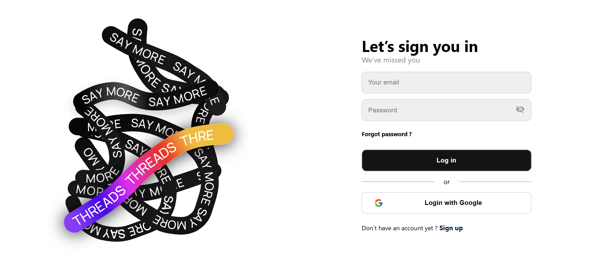

# 🚀 NeoThreads — Threads Clone

**NeoThreads** — это командный выпускной проект, разработанный в рамках профессиональной стажировки в [Neobis]

Проект представляет собой веб-приложение, повторяющее основные возможности социальной сети [Threads](https://www.threads.net/). Пользователи могут регистрироваться, авторизовываться, создавать публикации и просматривать контент в общей ленте.

Цель проекта — получить практический опыт командной разработки, построения компонентной архитектуры и реализации клиентской логики на React.

---

## 📸 Preview



---

## ✨ Основные возможности

- 🔐 **Регистрация и авторизация** — формы входа и создания аккаунта с валидацией пользовательских данных.
- 📝 **Создание публикаций** — возможность создавать и публиковать текстовые посты.
- 📰 **Лента публикаций** — просмотр опубликованных тредов пользователей.
- 🎨 **Современный интерфейс** — дизайн, вдохновлённый оригинальной социальной сетью Threads.
- 📱 **Адаптивная вёрстка** — интерфейс, адаптированный под различные размеры экранов.
- ⚛️ **Компонентная архитектура** — разделение приложения на переиспользуемые React-компоненты.
- 🔄 **Управление состоянием** — организация и обработка состояния приложения.

---

## 🛠 Технологический стек

| Категория | Технологии |
|---|---|
| Frontend | React, JavaScript |
| Разметка | HTML5 |
| Стилизация | SCSS, CSS Modules |
| Управление состоянием | Redux Toolkit |
| Работа с формами | Formik, Yup |
| HTTP-запросы | Axios |
| Авторизация | Google OAuth |
| Инструменты | Git, GitHub, npm, VS Code |

---

## 💻 Локальный запуск проекта

Для запуска проекта на локальном компьютере необходимо выполнить следующие шаги.

### 1. Клонирование репозитория

```bash
git clone <REPOSITORY_URL>
```

### 2. Переход в директорию проекта

```bash
cd neoThreads
```

### 3. Установка зависимостей

```bash
npm install
```

### 4. Запуск приложения

```bash
npm start
```

После успешного запуска приложение будет доступно в браузере по адресу:

[http://localhost:3000](http://localhost:3000)

---

## 👥 Команда проекта

Проект разработан в рамках командной работы во время профессиональной стажировки. В команде участвовали 5 человек.

### Мой вклад в проект

**Дастан Алмазбеков — Frontend Developer / Frontend Systems Engineer**

В рамках проекта отвечал за разработку клиентской части приложения:

- Реализация интерфейса и пользовательских компонентов на React.
- Разработка форм регистрации и авторизации.
- Реализация клиентской логики приложения.
- Работа с состоянием приложения и обработкой пользовательских действий.
- Интеграция интерфейсных компонентов в общую архитектуру проекта.
- Участие в формировании структуры и организации Frontend-кода.

---

## 🎥 Презентация проекта

Проект был представлен в рамках итоговой презентации стажировки.

📸 [Посмотреть выступление команды в Instagram](https://www.instagram.com/p/CyYBcVnoyBN/)

---

## 📌 Статус проекта

**Завершён.** Проект разработан в рамках выпускной командной работы на профессиональной стажировке.

---

⭐ Если проект оказался полезным или интересным, буду рад вашей оценке!